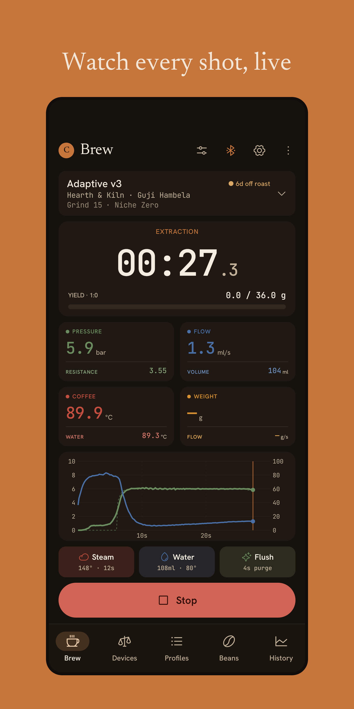
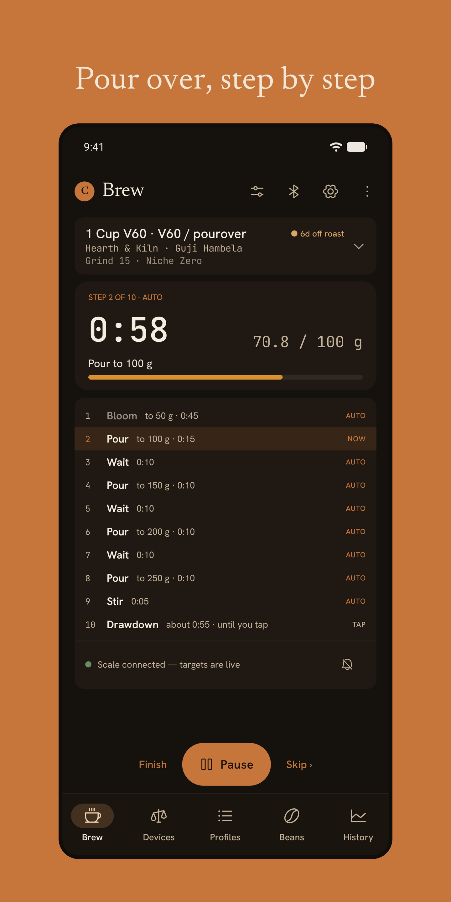
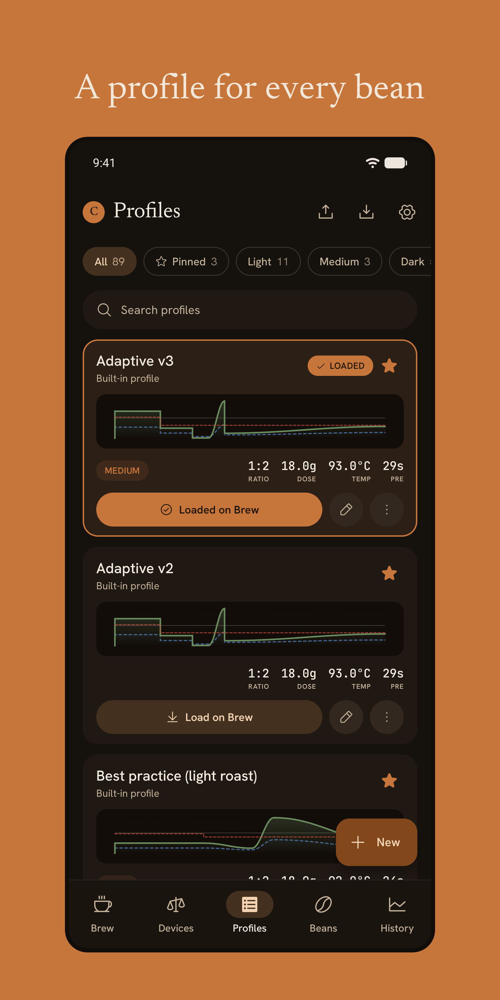
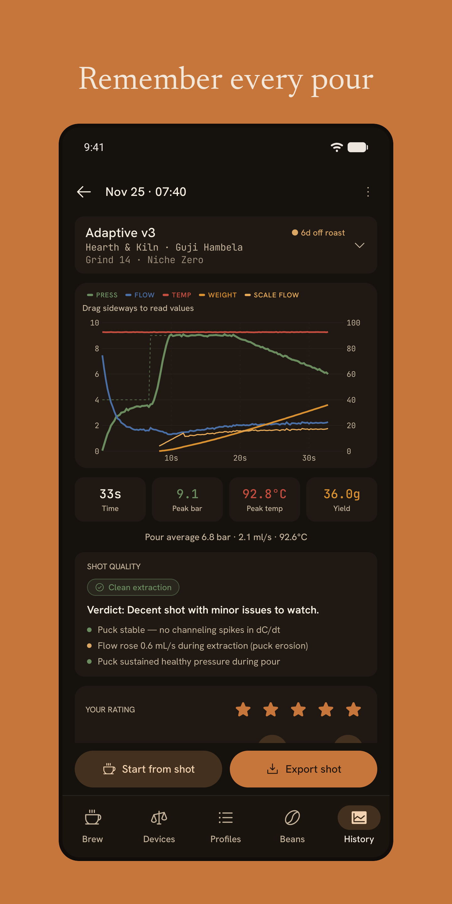

<div align="center">


# Crema

**A modern, open-source companion app for the [Decent Espresso DE1](https://decentespresso.com/).**

[](LICENSE)
[](https://www.rust-lang.org/)
[](https://kit.svelte.dev/)
[](android/)

</div>

---

> **Unofficial. Not affiliated with Decent Espresso.** Crema talks to the DE1 over its public Bluetooth GATT protocol. The official client is [`de1app`](https://github.com/decentespresso/de1app).

Crema is an independent, open-source DE1 companion: a **fast, type-safe, browser-based PWA** and a **native Android app** (tablet and phone), both built on one sans-IO Rust core that owns the protocol and domain logic. The shells own the UI and the Bluetooth transport.

Crema is not a clean-room implementation. It draws on existing open-source DE1 software for protocol behaviour and features: [`de1app`](https://github.com/decentespresso/de1app) (the official Tcl app), [`decaid`](https://github.com/decentespresso/decaid) (Decent's Dart app, formerly reaprime), [Decenza](https://github.com/Kulitorum/Decenza), [Beanconqueror](https://github.com/graphefruit/Beanconqueror) and [Visualizer](https://visualizer.coffee/). GPL-licensed code from these projects is referenced and adapted under Crema's own GPL license (see [License](#license)); source comments cite the upstream file behind each port.

> **▶ Try the live web app: [crema.maceiras.dev](https://crema.maceiras.dev)**. It runs in your browser, nothing to install. Pairing a DE1, scale or grinder needs a **Chromium** browser (Chrome, Edge, Brave) for Web Bluetooth, or the Beacio Safari extension on iPhone and iPad. Add it to your home screen to install it as an offline PWA. Prefer a native app? See **[Install on Android](#install-on-android)** below.

## Screenshots

<div align="center">




<br/>
<sub><b>Android phone</b> — live brew dashboard · guided pour-over · profile library · shot history</sub>
<br/><br/>
<sub><b>10&Prime; tablet:</b>
<a href="android/distribution/play-listing/en-US/images/tenInchScreenshots/01-brew-live.png">Brew</a> ·
<a href="android/distribution/play-listing/en-US/images/tenInchScreenshots/02-brew-manual.png">Manual</a> ·
<a href="android/distribution/play-listing/en-US/images/tenInchScreenshots/03-profiles.png">Profiles</a> ·
<a href="android/distribution/play-listing/en-US/images/tenInchScreenshots/04-history.png">History</a> ·
<a href="android/distribution/play-listing/en-US/images/tenInchScreenshots/05-beans.png">Beans</a> ·
<a href="android/distribution/play-listing/en-US/images/tenInchScreenshots/06-grinder.png">Grinder</a>
</sub>
</div>

## Features

Everything below ships in the web app and the Android app (tablet and phone) unless marked otherwise. *(nightly)* means it is on `main` and the Android nightly; the web app and the stable APK get it with the next release.

<!-- rumdl-disable MD036 -->

**Brew**

- **Two Brew modes, one screen**: the profile picker has two sections. Pick a DE1 profile for **Espresso**, or a recipe for **Manual** (filter and more), and Brew switches to match.
- **Live espresso dashboard**: real-time pressure, flow, temperature, weight and puck resistance against the profile's goal curves, a step-by-step phase list, stop conditions and shot-completion metrics.
- **Stop-at-weight that learns**: predictive stop-at-weight plus stop-at-volume. Crema learns how much drips in after the stop for each profile and scale pair (a port of Decenza's model) and stops early by that amount.
- **Profile library**: the 89 built-in de1app profiles (including Adaptive v3), pinning, a multi-step editor with a live curve preview, `.json` / `.tcl` import and community v2 JSON export.
- **Shot quality**: each shot in History gets a verdict with channeling, grind-direction and early-stop hints (ported from Decenza's shot analysis).
- **Quick Controls**: steam, hot water and flush with configurable targets.

**Manual brews (filter and more)**

- **Guided brews**: Manual mode on the Brew page runs a recipe step by step (bloom, pours, waits, drawdown) with a big clock, live weight against each target when a scale is connected, and cues.
- **Log any brew**: V60, Chemex, Kalita Wave, AeroPress, French press, Clever, siphon, moka, cold brew, drip, manual espresso, or your own **custom methods**. Each brew deducts its dose from the bag and sits in History next to your shots.
- **Credited built-in recipes**: 13 published recipes, each linked to its source: James Hoffmann, Tetsu Kasuya's 4:6, the official AeroPress recipe, Tuomas Merikanto, Stumptown and Hario. Duplicate one to make it your own.
- **Planned vs poured**: a guided brew's chart draws the recipe's planned staircase under the weight you actually poured, live and in History.

**Grinders**

- **Your grinders**: add them from a built-in catalogue of popular models with their grind scales, or set your own range, step and unit (numbers, clicks, microns). A grind is stored as typed, so "2.1.3" or "480 μm" both work.
- **Bag grinds**: each bag remembers its grind per grinder, and picking a bag sets it on Brew. Each shot records the grinder in use.
- **BOOKOO Motto 80 over Bluetooth** (beta, untested on hardware): connect it from Devices → Grinder, which shows burr gap, speed, state and grinds; Brew's grind follows the collar and each shot records it with the speed. Crema writes no settings to the grinder.

**Beans and history**

- **Shot history**: no limit, in its own database. Full telemetry for every shot, filters by profile, method and bean, pinning, multi-shot overlay comparison, community v2 `.shot.json` import/export and de1app `.shot` import.
- **Bean and roaster library**: bags, roast and open dates, freshness, grams remaining, photos, and a roaster's shelf of bags. Retroactively rebind a shot to a bag (the shot keeps a snapshot).
- **Roaster duplicate merge**: Crema spots roasters with the same name and offers to merge them. The bags move to one roaster and the duplicate is tagged, not deleted, so you can un-merge it later.
- **Beanconqueror import and export**: import beans, roasters and brews from a Beanconqueror export; export the bean library as a Beanconqueror ZIP.
- **Visualizer catalogue search** in the bean form: pick a coffee and Crema fills the empty fields.

**Machine and scales**

- **DE1 over Bluetooth**: connect, control and stream telemetry. Crema starts a shot, steam, hot water or a flush only when you tap; the optional pre-shot flush and post-steam purge (both off by default) run only as part of something you started. On connect it re-applies every machine setting it owns (fan, refill point, steam, hot water, flush, heater tweaks).
- **Bluetooth scales**: Bookoo Themis, Decent Scale and Half Decent Scale, Acaia (Lunar, Pyxis, Pearl and older models), Skale II, Felicita Arc, Eureka Precisa, Solo Barista, Varia Aku and Smartchef. Timemore Dot, Atomheart Eclair, DiFluid Microbalance (and Ti) and Hiroia Jimmy are experimental: they follow the reference apps but aren't yet checked against the hardware.
  - Bookoo Themis: native flow, and its beeper, auto-standby, flow-smoothing and auto-stop settings (auto-stop on the Mini, Ultra firmware 3.1.2 or earlier, and Ultra 4+ per timing and ratio mode, where it can also stop when the filter is removed); the display mode selector on the Mini; it keeps the scale awake while the DE1 is on (Mini 1.4.2+, Ultra 4.0.1+), can power it off (Mini 1.4.2+, Ultra 4.0+), and sends the dose to an Ultra (3.2.4+) for ratio mode.
  - A Half Decent Scale on firmware 3+ soft-sleeps with the DE1 instead of disconnecting.
- **Firmware updates** for the DE1.
- **Maintenance**: water filter, descale and clean reminders, tank level with a low-water warning, and buttons that run the DE1's descale, clean and air-purge cycles, including on a cold machine with firmware older than build 1356.
- **Tablet charging control** for a tablet powered from the DE1's USB port: Always on (default), Smart (55 to 65 %) or High (90 to 95 %).
- **Stolen-machine notice**: if the connected DE1's serial is on Decent's stolen or lost list, Settings shows a one-line notice.

**Sync and backup** (all opt-in; Crema is local-first and has no account of its own)

- **Visualizer**: OAuth 2.0 + PKCE sign-in. Shots upload, pull and sync edits; beans and roasters sync both ways, last write wins. Coffee-bag and roaster writes need Visualizer Premium; on free accounts Crema skips Premium-only shot fields.
- **Decent account**: upload every shot to your decentespresso.com shot history in the format the tablet app and decaid use, get a share link, and have edits re-uploaded.
- **Backups**: a `.crema.zip` with profiles, beans (with photos), shots and settings that restores on either shell. Google Drive backup is automatic on Android and on demand on the web, and the web app reminds you when the last backup is two weeks old.
- **Webhooks** (web): outgoing POSTs when a shot finishes, the DE1 or a scale connects, a profile is uploaded, or the machine reports an error.
- **Capture and replay**: record BLE sessions and replay them through the core, in the web app (Settings → Advanced) or in tests.

<!-- rumdl-enable MD036 -->

## Install on Android

<p align="center">
  <a href="https://apps.obtainium.imranr.dev/redirect?r=obtainium://add/https://github.com/geota/crema"></a>
  <a href="https://github.com/geota/crema/releases/latest"></a>
  <!--
    Not listed yet (both package pages return 404 as of 2026-11-24). To re-enable, move these
    badges above this comment once dev.maceiras.crema is live there, and restore the
    IzzyOnDroid bullet under "Stable":
  <a href="https://f-droid.org/packages/dev.maceiras.crema/"></a>
  <a href="https://apt.izzysoft.de/fdroid/index/apk/dev.maceiras.crema"></a>
  -->
</p>

<sub>F-Droid, IzzyOnDroid and Google Play: planned, not listed yet.</sub>

> The Android app is in active development. Builds ship on two **trains**; pick whichever you want to follow.

**Stable**: tagged releases.

- Download the APK from the [latest release](https://github.com/geota/crema/releases/latest). See the **[changelog](CHANGELOG.md)** for what each release includes. Each release has two:
  - **`crema-<version>-play.apk`**: for phones with Google Play services (or microG). Google Drive sign-in goes through them, and opens the browser where they don't work. Settings → Google Drive can also sign in through the browser instead.
  - **`crema-<version>-foss.apk`**: no Google code at all, the build F-Droid and IzzyOnDroid ship. Google Drive sign-in opens the browser.

  Both are the same app with the same signature, so either installs over the other and keeps your data. Obtainium asks which one to follow.

- Or add `https://github.com/geota/crema` to **Obtainium** (steps below) with **Include prereleases** off.

<!--
- **[IzzyOnDroid](https://apt.izzysoft.de/)** (an F-Droid-compatible repo): add `https://apt.izzysoft.de/fdroid/repo` to your F-Droid client, then search for **Crema**.
-->

**Nightly**: the latest commit on `main`, rebuilt on every push.

- **[Obtainium](https://github.com/ImranR98/Obtainium)** (recommended; installs *and* auto-updates straight from GitHub):
  1. Install Obtainium itself, from its [GitHub releases](https://github.com/ImranR98/Obtainium/releases).
  2. Tap **Add App** and paste the source URL `https://github.com/geota/crema`.
  3. Turn on **Include prereleases**: the nightly build is published as a GitHub *prerelease*.
  4. Tap **Add**, then **Install**. Obtainium updates it in place whenever a new nightly ships.
- Or download the APK straight from the [`nightly`](https://github.com/geota/crema/releases/tag/nightly) prerelease and sideload it. Nightlies are the `play` build.

Stable and nightly are the **same app** (`dev.maceiras.crema`), signed with the same key and sharing one strictly increasing version scheme: a nightly's version code sits just above the release it builds on and below the next one, so **every tagged release is an in-place upgrade over the nightlies that preceded it**, with no manual reinstall. The **Include prereleases** switch just picks which lane you follow. Minimum Android 12 (API 31).

## Tech stack

| Layer | Technology |
|---|---|
| **Core** | Rust (sans-IO, edition 2024), compiled to WebAssembly via `wasm-bindgen` and to Android via UniFFI. Protocol, scale and grinder codecs, the shot state machine, stop-at-weight, profiles, beans, grinders, recipes, shot history rules, backups, the LAN relay's secure channel (SPAKE2 pairing, Noise sessions) and the Visualizer / Decent wire formats. No I/O, no UI; fully testable without hardware. |
| **Web shell** | SvelteKit 2 + Svelte 5 (runes), TypeScript, adapter-static, Effect for services, uPlot charts. Web Bluetooth for the DE1, scales and grinder. PWA with offline install, hosted on Cloudflare Pages. |
| **Android shell** | Kotlin + Jetpack Compose (Material 3), separate tablet and phone layouts, Nordic BLE, Ktor. Two distributions: `foss` and `play`. |
| **Bindings** | `typeshare` generates the shared Rust types for both shells (TypeScript **and** Kotlin); `UniFFI` bridges the core to Android; `openapi-typescript` types the Visualizer API. |
| **Storage** | Shot history in SQLite through the core on both shells (on the web, on OPFS in a Worker). Web: `localStorage` for settings, profiles and beans; IndexedDB for bean photos and BLE captures. Stored credentials are encrypted at rest. |

## Quick start

### Prerequisites

- **Rust** 1.95+ (`rust-version` in `core/Cargo.toml`; CI pins 1.95.0) with the `wasm32-unknown-unknown` target and `wasm-pack` (`cargo install wasm-pack`)
- A **clang with a wasm32 backend** and `llvm-ar` for the history store's wasm (Apple's clang has none; see [`core/de1-history-wasm/README.md`](core/de1-history-wasm/README.md))
- **Node.js** 24 (see `.nvmrc`)
- **[pnpm](https://pnpm.io/)** 11: the repo pins `pnpm@11.5.0` via `packageManager`; run `corepack enable` and the matching version is used automatically
- A browser with [Web Bluetooth](https://caniuse.com/web-bluetooth) support: Chrome / Edge / Opera. Brave works after enabling the flag (see below).

<details>
<summary><strong>Enabling Web Bluetooth in Brave</strong></summary>

Brave ships Web Bluetooth disabled by default. To turn it on:

1. Open `brave://flags/#brave-web-bluetooth-api` (paste the URL into the address bar).
2. Set the **Web Bluetooth API** flag to **Enabled**.
3. Click **Relaunch** at the bottom of the page.

After the restart, Brave prompts for device-picker permissions like Chrome does.

</details>

### Run the dev server

```bash
git clone https://github.com/geota/crema.git
cd crema/web
pnpm install
pnpm wasm           # wasm build of the Rust core (re-run after core changes)
pnpm wasm:history   # the SQLite history store for the Worker
pnpm dev
```

Open `http://localhost:5173` and click **Connect** to pair your DE1 over Web Bluetooth. No machine handy? Settings → Advanced → **Replay a capture** plays a recorded session (e.g. `core/de1-app/tests/fixtures/*.jsonl`) through Brew and into History.

> **Pairing tip: the DE1 may advertise as `nRF5x` in the browser's Web Bluetooth picker.**

### Visualizer and Google Drive (optional)

Visualizer sign-in needs a public Doorkeeper application from <https://visualizer.coffee/oauth/applications>; Google Drive backup needs a Google OAuth client ID. Put both in a local env file:

```bash
cp web/.env.example web/.env.local
# Edit web/.env.local: VITE_VISUALIZER_CLIENT_ID, VITE_GOOGLE_DRIVE_CLIENT_ID
```

### Build for production

```bash
pnpm build         # wasm + history wasm + static site → web/build/
```

[`DEPLOY.md`](DEPLOY.md) covers the web deploy.

### Android

Build instructions, the architecture notes and the UniFFI / `cargo-ndk` toolchain live in [`android/README.md`](android/README.md).

### Run the test suite

```bash
# Rust core
cd core
cargo test --workspace

# Web shell type-check + unit tests
cd web
pnpm check       # svelte-check (type-check)
pnpm test        # vitest unit tests
```

Some web tests need the test build of the core first: `pnpm wasm:test` (and `pnpm wasm:history:test` for the history store). Re-run `pnpm wasm` after any core change, or the tests use a stale bundle. Markdown and links: `just docs` (rumdl, tombi) and `just links` (lychee).

### Git hooks

A pre-push hook in `.githooks/` mirrors the CI `rust` and `web` jobs: `cargo fmt --check`, `cargo clippy -D warnings`, `cargo test`, the built-in profile id check, then `pnpm install --frozen-lockfile`, `pnpm wasm`, `pnpm wasm:history`, `pnpm check` and `pnpm build`. It is slow; let it finish. `pnpm install` wires it up (via the `prepare` script). To (re)install it by hand:

```bash
scripts/install-hooks.sh   # or: git config core.hooksPath .githooks
```

Bypass for a one-off push with `SKIP_CI_CHECKS=1 git push` (or skip one half with `SKIP_RUST=1` / `SKIP_WEB=1`); CI still runs on the remote.

### CI

- **`ci.yml`** (push / PR to `main`): Rust fmt, clippy, tests, built-in ids and typeshare-bindings freshness, `cargo deny`; web `pnpm check`, vitest and build; the history wasm and its Playwright browser tests; the Android unit tests, lint and debug APKs (`foss` and `play`); an advisory `cargo audit` / `pnpm audit`, which also runs weekly. A nightly schedule runs the relay fuzzer, the long model runs and the history benchmarks.
- **`security-lockfile.yml`** (daily): patches advisories in transitive web dependencies, which Dependabot's security updates can't do with pnpm 11. `scripts/fix-transitive-advisories.mjs` moves only the vulnerable packages in `web/pnpm-lock.yaml` (a commented override in `web/pnpm-workspace.yaml` only when a parent pins one), skips patched versions younger than pnpm's release-age policy, and keeps one rolling PR from `security/transitive-fixes`. A short-lived token from the repo's security bot GitHub App (variable `SECURITY_APP_CLIENT_ID`, secret `SECURITY_APP_PRIVATE_KEY`) pushes and opens the PR, so CI runs on it. Rulesets keep the app off `main` and `v*` tags. Run it locally with `cd web && node ../scripts/fix-transitive-advisories.mjs`.
- **`nightly.yml`** (push to `main`): builds the `play` APK and republishes the rolling `nightly` prerelease.
- **`release.yml`** (`v*.*.*` tag): builds the `-foss` and `-play` APKs, the Play AAB and the PWA bundle, publishes the GitHub Release and deploys the web app to Cloudflare Pages. No debug APK: the nightly is the test build. Releases go through a PR: `scripts/cut-release.sh X.Y.Z -m "…"` opens the release-notes PR, and after it merges `scripts/cut-release.sh --tag X.Y.Z` tags `main`, which starts this workflow.
- **`pr-title.yml`**: checks the PR title prefix.

## Project layout

```text
crema/
├── core/                     # Rust workspace (sans-IO, edition 2024)
│   ├── de1-protocol/         #   DE1 BLE wire codec (state, shot samples, MMR, profiles, firmware)
│   ├── de1-scale/            #   Per-scale BLE codecs (13 scale families)
│   ├── de1-device/           #   What BLE devices share: kinds, scan registry, link health, firmware
│   ├── de1-grinder/          #   Connected-grinder drivers (BOOKOO Motto 80) + grind detection
│   ├── de1-domain/           #   Shots, profiles, beans, grinders, recipes, stop-at-weight, sync, import/export
│   ├── de1-app/              #   Orchestrator: the `CremaCore` facade + event stream, capture/replay
│   ├── de1-relay/            #   LAN relay secure channel: SPAKE2 pairing, Noise sessions
│   ├── de1-relay-app/        #   LAN relay app layer: relayed commands, their wire form, refusal rules
│   ├── de1-history/          #   Shot history database rules: derived columns, typed queries, SQL
│   ├── de1-history-wasm/     #   The web's history store: SQLite on OPFS in a Worker
│   ├── de1-wasm/             #   wasm-bindgen bridge for the web shell
│   ├── de1-ffi/              #   UniFFI bridge for the Android shell
│   ├── de1-model/, *-model/  #   DE1 simulator and property tests (outside the workspace)
│   └── bindings/             #   Generated shared types (typeshare → .ts + .kt)
├── web/                      # SvelteKit PWA
│   ├── src/lib/              #   Core wrapper, stores, components, BLE transports, Effect services
│   ├── src/routes/           #   / (Brew: Espresso and Manual), /profiles, /beans, /history,
│   │                         #   /scale (Devices: Scale and Grinder tabs), /settings,
│   │                         #   /auth (Visualizer callback), /privacy, /terms
│   └── static/               #   Icons, manifest, PWA assets
├── android/                  # Native Jetpack Compose app (tablet + phone)
│   ├── app/src/main/java/coffee/crema/
│   │                         #   ble/ (+ companion/, proxy/ LAN relay) · core/ (UniFFI) · ui/ (screens, phone/, brewlog/)
│   │                         #   beans · brew · history · profiles · machine · maintenance · firmware · settings
│   │                         #   visualizer · decent · drive · sync · restore · persist · net · security · update · diag
│   ├── app/src/foss/, play/  #   Per-distribution code (Google Drive sign-in)
│   └── distribution/         #   Play listing images, "What's new" notes
├── fastlane/metadata/        # F-Droid / IzzyOnDroid store metadata
├── brand/                    # Logo sources
├── scripts/                  # cut-release.sh, install-hooks.sh, history wasm build, advisory fixer
├── justfile                  # Local dev commands: docs, links, coverage, mutants
├── .githooks/                # Pre-push hook mirroring CI
└── .github/                  # workflows/ (ci · nightly · release · security-lockfile · pr-title)
```

## Native Android app

The Android app is a full native client of the same core, not a remote. It uses Jetpack Compose with separate tablet and phone layouts (the phone has its own navigation and screens for Brew, Profiles, Beans, History, Devices and Settings) and calls the Rust core through [UniFFI](https://github.com/mozilla/uniffi-rs). The protocol codecs, shot state machine, stop logic, profile model, bean, grinder and history stores, backups, the relay's secure channel, and the Visualizer and Decent wire formats are **one source of truth across web and Android**: a protocol fix lands once in Rust and both shells inherit it.

Most features ship to web, tablet and phone together; the [changelog](CHANGELOG.md) says which shells each change reaches. Where they differ today:

- **Android only**:
  - **Hub and remotes**: one device (with Hub mode on) holds the Bluetooth link, and other phones and tablets connect through it on the LAN, encrypted, each paired once with a 6-digit code.
  - A background connection that keeps the DE1 link and reconnect loop alive with the screen off (opt-in, and only while charging).
  - Automatic Google Drive backup, and an on-demand update check against GitHub releases.
- **Web only**: webhooks, and Replay a capture.

## Contributing

Issues and pull requests welcome. The codebase aims for:

- **Type-driven design**: make illegal states unrepresentable.
- **Sans-IO core**: protocol and domain logic tested without hardware.
- **Behavioural fidelity**: bytes, timing and state transitions match the DE1's firmware and the reference apps; structure is free to evolve.
- **Tight, idiomatic code**: no speculative abstractions; YAGNI is a best practice.

Before opening a PR:

```bash
cd core && cargo test --workspace && cargo clippy --workspace --all-targets -- -D warnings
cd ../web && pnpm check && pnpm test && pnpm build
```

Each user-visible change gets a [changelog](CHANGELOG.md) entry that says which shells it reaches.

## Acknowledgements

- **[Decent Espresso](https://decentespresso.com/)** for the DE1 hardware and the open Bluetooth protocol.
- **[`de1app`](https://github.com/decentespresso/de1app)**, the official Tcl app and canonical reference for protocol behaviour, the built-in profiles and maintenance flows.
- **[`decaid`](https://github.com/decentespresso/decaid)** (formerly [reaprime](https://github.com/tadelv/reaprime)), Decent's Dart app: protocol cross-checks, the Decent shot-upload format and scale handling such as the Half Decent Scale's soft sleep.
- **[Decenza](https://github.com/Kulitorum/Decenza)**: the stop-at-weight learning model, shot-quality analysis, cold-machine maintenance and smart tablet charging are ported from it.
- **[BOOKOO](https://github.com/BooKooCode/OpenSource)** for publishing the Motto 80 and scale protocols, and Sabotage1's [decaid Motto 80 plugin](https://github.com/Sabotage1/decaid-bookoo-motto80).
- **[Beanconqueror](https://github.com/graphefruit/Beanconqueror)** for its export format, which Crema imports and writes.
- **[Visualizer](https://visualizer.coffee/)** ([source](https://github.com/miharekar/visualizer)) for the shot-sharing service, its public API and the coffee catalogue.
- **[openscale](https://github.com/decentespresso/openscale)**, the Decent Scale firmware, for the scale's wire details.
- The recipe authors credited in the app (James Hoffmann, Tetsu Kasuya, AeroPress, Tuomas Merikanto, Stumptown, Hario).
- **The Decent community** (Diaspora forum, Discord and r/decentespresso) for collective wisdom on shot dynamics, profile design and the protocol's many undocumented quirks.

## Built with AI assistance

Crema was built with heavy use of **large-language-model (LLM)-assisted development**, including Anthropic's [Claude](https://www.anthropic.com/claude) (via [Claude Code](https://www.claude.com/claude-code)) for much of its code, design and documentation. The project is reviewed and tested, but AI-assisted software can carry subtle defects. Please mind the [no-warranty, use-at-your-own-risk Terms](https://crema.maceiras.dev/terms) (especially around machine control), and report anything that looks off in a [GitHub issue](https://github.com/geota/crema/issues).

## License

Crema is licensed under the **GNU General Public License v3.0 or later**; see [`LICENSE`](LICENSE). This matches the DE1 ecosystem (`de1app`, `decaid`, Decenza and Beanconqueror are GPL-3.0), so GPL-licensed code from those projects is referenced and adapted here. Bundled third-party assets are listed in [`THIRD-PARTY-NOTICES.md`](THIRD-PARTY-NOTICES.md).

Copyright © 2026 Adrian Maceiras.
