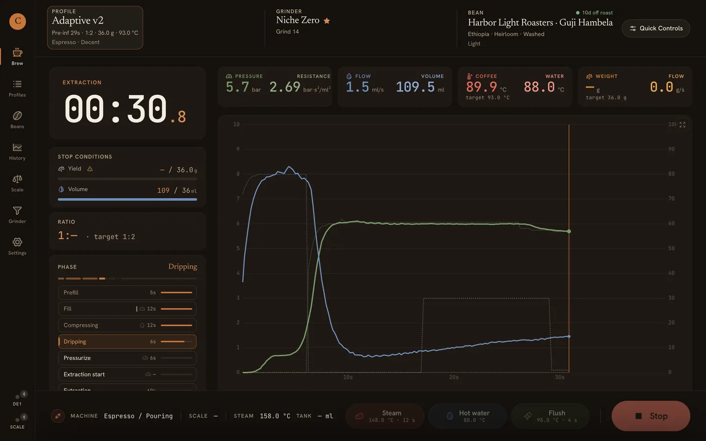
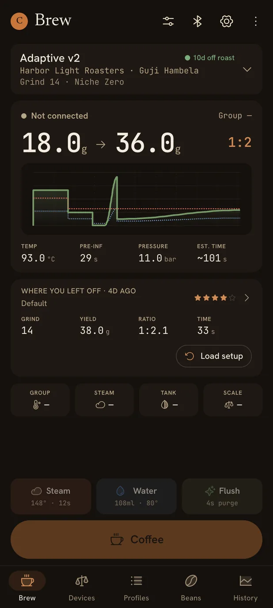
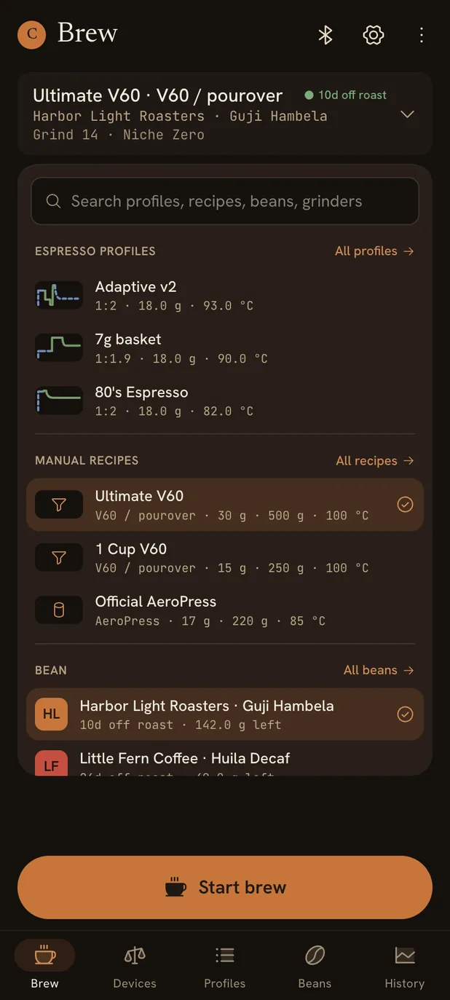
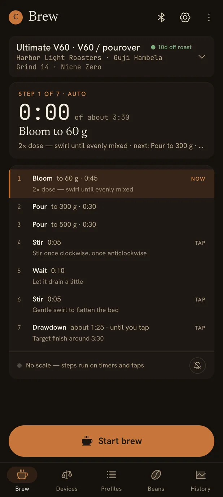
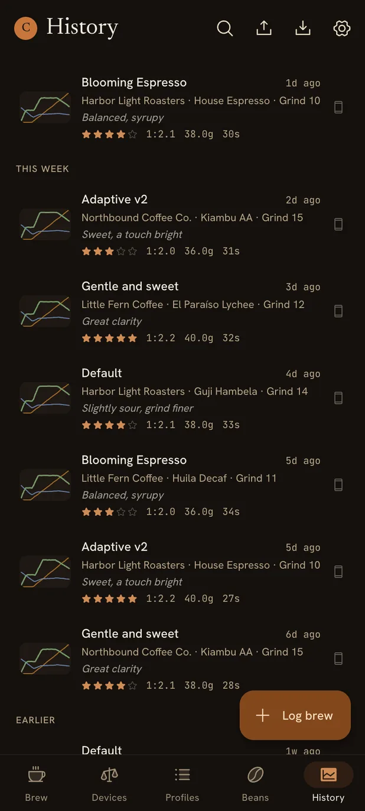
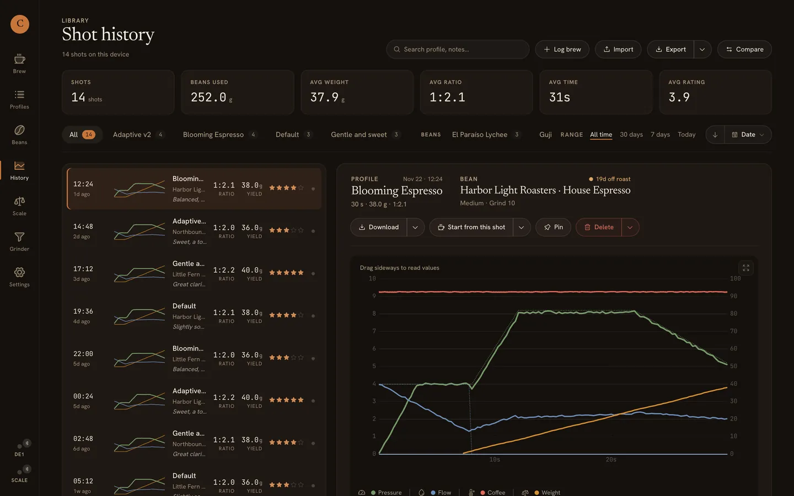
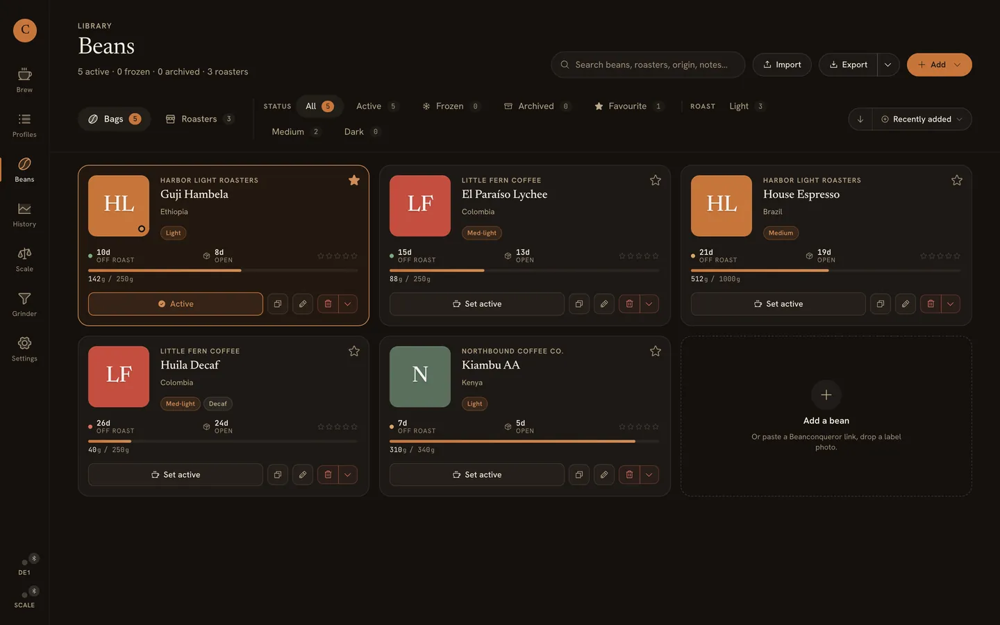
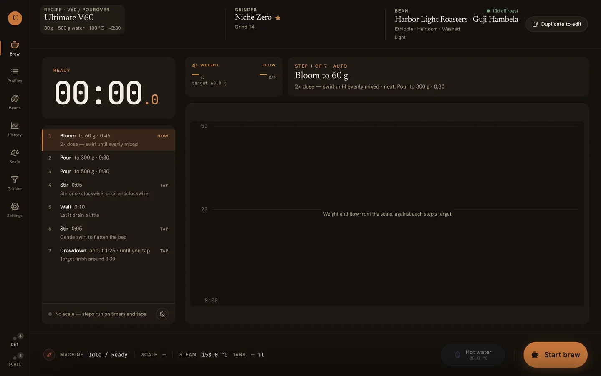
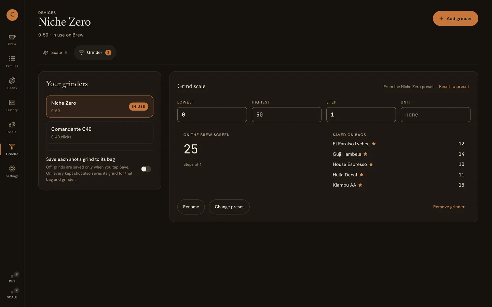

# Crema

**An open-source companion app for the [Decent Espresso DE1](https://decentespresso.com/): a web app and a native Android app on one Rust core.**

**[Open the web app](https://crema.maceiras.dev)** · **[Android APK](https://github.com/geota/crema/releases/latest)** · **[Obtainium](https://apps.obtainium.imranr.dev/redirect?r=obtainium://add/https://github.com/geota/crema)** · [Changelog](CHANGELOG.md)

> **Unofficial. Not affiliated with Decent Espresso.** Crema talks to the DE1 over its public Bluetooth protocol. The official app is [`de1app`](https://github.com/decentespresso/de1app).

- **Your data stays with you.** Shots, beans and profiles live on your device (Android) or in your browser (web). Backups go to a file, or to your own Google Drive if you connect it.
- **No account.** Crema has no server and no sign-up. Visualizer and Decent uploads are opt-in.
- **You start the machine.** Crema starts a shot, steam, hot water or a flush only when you tap. The optional pre-shot flush and post-steam purge (both off by default) run only as part of something you started. Without a tap, Crema only re-applies your saved machine settings on connect and puts an idle machine to sleep after your timeout.

## Screenshots

 Brew, Espresso mode: live pressure and flow against the profile's goals, with the phase list and stop conditions.
  

 Phone: Brew (Espresso) · the picker's two sections, Espresso profiles and Manual recipes · Brew (Manual) with a V60 recipe · History.
  

 History with a shot's chart · the bean library.
  

 Brew (Manual) · Devices → Grinder: the grind scale and each bag's saved grind.

Web app with sample data. Android: [phone](android/distribution/play-listing/en-US/images/phoneScreenshots/) and [tablet](android/distribution/play-listing/en-US/images/tenInchScreenshots/) store images.

## Features

Web, Android tablet and Android phone unless marked. *(nightly)*: on `main` and the Android nightly; the web app and the stable APK get it with the next release.

| Area | What you get |
|---|---|
| **Brew modes** *(nightly)* | One Brew screen, two modes picked from the profile picker's two sections: **Espresso** (a DE1 profile) or **Manual** (a guided recipe for V60, AeroPress, Chemex, French press and more, step by step, with live weight against each target when a scale is connected). |
| **Live espresso** | Pressure, flow, temperature, weight and puck resistance against the profile's goal curves; phase list; stop at weight (it learns each profile and scale's drip-through) or at volume; Quick Controls for steam, hot water and flush. |
| **Profiles** | The 89 built-in de1app profiles (including Adaptive v3), a multi-step editor with live curve preview, `.json` / `.tcl` import, v2 JSON export. |
| **Recipes** | 13 credited built-in recipes (James Hoffmann, Tetsu Kasuya's 4:6, AeroPress, Stumptown, Hario and others), your own recipes and brew methods. |
| **Grinders and bag grinds** *(nightly)* | Your grinders with their grind scales, from a built-in catalogue of popular models. Each bag remembers its grind per grinder, and picking a bag sets it on Brew. |
| **Shot history** | No limit, in its own database. Filters, overlay comparison, shot-quality hints, pinning, v2 `.shot.json` import/export, de1app `.shot` import. |
| **Beans** | Bags and roasters, freshness, grams left, photos, roaster merge, Beanconqueror import and export, Visualizer catalogue search. |
| **Backups** | One `.crema.zip` (profiles, beans with photos, shots, settings) that restores on either app. Google Drive: automatic on Android, on demand on the web. The web app reminds you when the last backup is two weeks old. |
| **Sharing** | Visualizer (shots, beans and roasters, synced both ways) and Decent account shot upload. Both opt-in. |
| **Machine care** | Filter, descale and clean reminders, tank level, guided descale / clean / air purge, DE1 firmware updates, tablet charging control. |
| **Hub and remotes** (Android) | One device holds the Bluetooth link; other phones and tablets connect through it over the LAN, encrypted, each paired once with a 6-digit code. |
| **Android only** | Background connection while charging (opt-in), update check, `-foss` and `-play` APKs ([below](#install)). |
| **Web only** | Webhooks; Settings → Advanced → Replay a capture plays a recorded session through the app. |

## Device support

| Device | Status | What Crema does | Android | Web |
|---|---|---|---|---|
| **Decent DE1** | Supported | Connect, upload profiles, run and stop shots, steam, hot water, flush, maintenance cycles, firmware updates. | Yes | Yes |
| **Bookoo Themis** | Supported | Weight, tare, timer, native flow; beeper, auto-standby and flow smoothing settings; auto-stop setting (Mini, and Ultra firmware 3.1.2 or earlier or 4+); keeps the scale awake while connected (Mini 1.4.2+, Ultra 4.0.1+) and can power it off (Mini 1.4.2+, Ultra 4.0+). | Yes | Yes |
| **Decent Scale, Half Decent Scale** | Supported | Weight, tare, timer, display and power-off; a Half Decent Scale on firmware 3+ soft-sleeps with the DE1 instead of disconnecting. | Yes | Yes |
| **Acaia** (Lunar, Pyxis, Pearl, older models) | Supported | Weight and tare. | Yes | Yes |
| **Skale II, Felicita Arc, Eureka Precisa, Solo Barista, Varia Aku** | Supported | Weight and tare; the scale's timer, except on the Aku. | Yes | Yes |
| **Smartchef** | Supported | Weight; tare in the app (the scale has no Bluetooth commands). | Yes | Yes |
| **Timemore Dot, Atomheart Eclair, DiFluid Microbalance (and Ti), Hiroia Jimmy** | Experimental | Weight and tare, following the reference apps; not yet checked against the hardware. | Yes | Yes |
| **BOOKOO Motto 80** grinder | Beta, off by default *(nightly)* | Turned on in Settings. Shows burr gap, speed, state and grinds; Brew's grind follows the collar and each shot records it with the speed. Writes no settings to the grinder. | Yes | Yes |

Web Bluetooth needs a Chromium browser (Chrome, Edge, or Brave with its Web Bluetooth flag on) or, on iPhone and iPad, the Beacio Safari extension. Add the web app to your home screen to use it offline.

## Install

**Web:** open [crema.maceiras.dev](https://crema.maceiras.dev). Nothing to install.

**Android** (12+): each [release](https://github.com/geota/crema/releases/latest) has two APKs with the same signature, so either installs over the other and keeps your data.

| APK | For |
|---|---|
| `crema-<version>-play.apk` | Phones with Google Play services or microG. Drive sign-in goes through them, falling back to the browser where they don't work. |
| `crema-<version>-foss.apk` | No Google code (the F-Droid / IzzyOnDroid build). Drive sign-in opens the browser. |

- **Stable**: tagged releases ([changelog](CHANGELOG.md)).
- **Nightly**: every push to `main`, as the [`nightly`](https://github.com/geota/crema/releases/tag/nightly) prerelease (the `play` build).
- **[Obtainium](https://github.com/ImranR98/Obtainium)** installs and updates either one: add `https://github.com/geota/crema`, with **Include prereleases** on for nightly. A release always upgrades over the nightlies before it.

F-Droid, IzzyOnDroid and Google Play: planned, not listed yet.

## Code layout

One sans-IO Rust core owns the protocol and the domain logic; each shell owns its UI and its Bluetooth radio.

| Path | What it is |
|---|---|
| `core/de1-protocol` | DE1 Bluetooth wire codecs: state, shot samples, MMR, profiles, firmware. |
| `core/de1-scale` | Codecs for every supported scale, and how a scan recognises them. |
| `core/de1-device` | What non-DE1 devices share: kinds, scan registry, link health, firmware versions. |
| `core/de1-grinder` | Connected-grinder drivers (BOOKOO Motto 80) and grind detection. |
| `core/de1-domain` | Shots, profiles, beans, grinders, recipes, stop-at-weight, sync, import/export, backups. |
| `core/de1-app` | The `CremaCore` facade both shells drive: event stream, shot start, capture and replay. |
| `core/de1-relay` | LAN relay secure channel: SPAKE2 pairing, Noise sessions. |
| `core/de1-relay-app` | LAN relay app layer: relayed commands, their wire form and refusal rules. |
| `core/de1-history` | Shot history database rules: derived columns, typed queries, SQL. |
| `core/de1-history-wasm` | The web's history store: SQLite on OPFS in a Worker. |
| `core/de1-ffi`, `core/de1-wasm` | UniFFI bridge for Android; wasm-bindgen bridge for the web. |
| `core/de1-model`, `core/*-model` | A DE1 and scale simulator, and property tests (outside the workspace). |
| `core/bindings` | Generated shared types (typeshare: TypeScript and Kotlin). |
| `web/` | SvelteKit 2 + Svelte 5 PWA: `src/routes` (Brew, Profiles, Beans, History, Devices, Settings), `src/lib` (core wrapper, state, BLE, services). |
| `android/` | Kotlin + Jetpack Compose app for tablet and phone ([`android/README.md`](android/README.md)). |
| `scripts/`, `.githooks/`, `.github/` | Release and hook scripts, the pre-push hook, CI workflows. |

## Contributing

Issues and pull requests are welcome. **[CONTRIBUTING.md](CONTRIBUTING.md)** has the setup, the dev server, tests, hooks and CI; [`DEPLOY.md`](DEPLOY.md) covers the web deploy.

## Acknowledgements

Crema is not a clean-room implementation. It follows these projects and, where licensed, adapts their code; source comments cite the upstream file behind each port.

- **[Decent Espresso](https://decentespresso.com/)** for the DE1 and its open Bluetooth protocol; **[`de1app`](https://github.com/decentespresso/de1app)**, the reference for protocol behaviour, built-in profiles and maintenance.
- **[`decaid`](https://github.com/decentespresso/decaid)** (formerly [reaprime](https://github.com/tadelv/reaprime)): protocol cross-checks, the Decent shot upload, scale handling.
- **[Decenza](https://github.com/Kulitorum/Decenza)**: stop-at-weight learning, shot-quality analysis, cold-machine maintenance, smart charging.
- **[BOOKOO](https://github.com/BooKooCode/OpenSource)** for publishing the Motto 80 and scale protocols, and Sabotage1's [decaid Motto 80 plugin](https://github.com/Sabotage1/decaid-bookoo-motto80).
- **[Beanconqueror](https://github.com/graphefruit/Beanconqueror)** (its export format), **[Visualizer](https://visualizer.coffee/)** ([source](https://github.com/miharekar/visualizer)) (shot sharing, API, coffee catalogue), **[openscale](https://github.com/decentespresso/openscale)** (Decent Scale firmware).
- The recipe authors credited in the app, and the Decent community for years of shared knowledge.

## Built with AI assistance

Much of Crema's code, design and documentation was written with large-language-model help, mainly Anthropic's [Claude](https://www.anthropic.com/claude) via [Claude Code](https://www.claude.com/claude-code). It is reviewed and tested but may still have subtle defects: see the [no-warranty Terms](https://crema.maceiras.dev/terms) (especially on machine control) and report anything odd in an [issue](https://github.com/geota/crema/issues).

## License

[GPL-3.0-or-later](LICENSE), like `de1app`, `decaid`, Decenza and Beanconqueror, whose GPL code is referenced and adapted here. Bundled third-party assets: [`THIRD-PARTY-NOTICES.md`](THIRD-PARTY-NOTICES.md).

Copyright © 2026 Adrian Maceiras.
